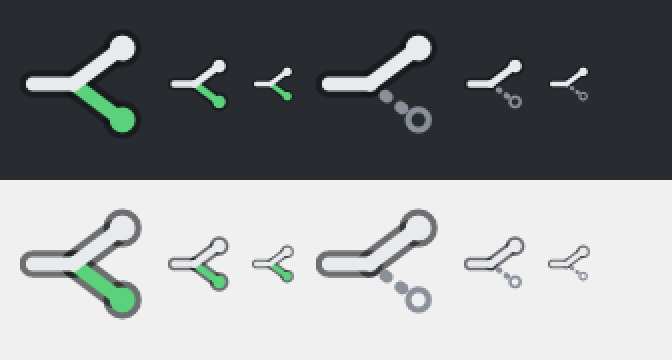

# audio-stream-control

App with tray that lets you choose which sounds are *copied* into a target sink —
for example a sink whose monitor you stream to friends via Discord or RustDesk.
You keep hearing everything as before. Untick → the copy is gone.

Nothing is permanent: the links belong to this process, so PipeWire removes
them when you untick, choose "Stop sharing everything", quit, or the app dies.
Shares are "sticky" while the app runs: if a shared app closes and reopens
its sound, it is linked again automatically.

## Requirements

- Linux with PipeWire (and `pipewire-pulse` / WirePlumber as usual)
- A system tray (see below)
- To build: Rust 1.88+, clang, pkg-config, PipeWire headers

## Build

Arch:

    sudo pacman -S --needed rust clang pkgconf pipewire
    cargo build --release

Debian / Ubuntu:

    sudo apt install libpipewire-0.3-dev clang pkg-config
    cargo build --release

Binary: `target/release/audio-stream-control`

## Config

`~/.config/audio-stream-control/config.toml` — created with commented
examples on first start. Read once at startup (restart the app after edits).

    # sink that receives the copies (pactl list short sinks)
    target = "loopback-sink"

    # size of text and buttons in the window (1.0 = small egui default)
    ui_scale = 1.5

    # sinks offered as one entry each; everything playing into them is shared
    [[sources]]
    sink  = "game-sink"
    label = "Game Audio"

`--target SINK` overrides `target` for one run.

## Window icon and app menu entry

    cp ./target/release/audio-stream-control ~/.local/bin/
    cd ~/.local/bin/
    ./audio-stream-control --install-desktop-entry

Writes the icon to `~/.local/share/icons/hicolor/` and a `.desktop` file to
`~/.local/share/applications/`. On Wayland a window's icon comes from the
`.desktop` file matching its app id, so this is what replaces the generic icon.
Re-run it if you move the binary (the file stores its path).

## Using it

- Right-click the icon: quick menu.
- Left-click the icon, or "Open window…": a small window with the same list
  that stays open while you tick several things. Closing it returns to the tray.
  Ctrl + / Ctrl − zoom it further.
- Icon: a line forking in two. Lower branch green = something is shared;
  grey and dotted = nothing is shared.

## Tray support

- KDE Plasma: works out of the box
- GNOME: needs the AppIndicator / KStatusNotifierItem extension
- niri, Sway, Hyprland…: needs a bar with a tray (e.g. waybar's `tray` module)

## Files

- `src/main.rs`   – starts everything, command line, desktop entry install
- `src/config.rs` – reads / creates the config file
- `src/pw.rs`     – PipeWire: watches the graph, creates/removes links
- `src/tray.rs`   – tray icon and menu
- `src/window.rs` – the window (egui)
- `src/icon.rs`   – draws the icon in code

## License

MIT — see [LICENSE](LICENSE).
